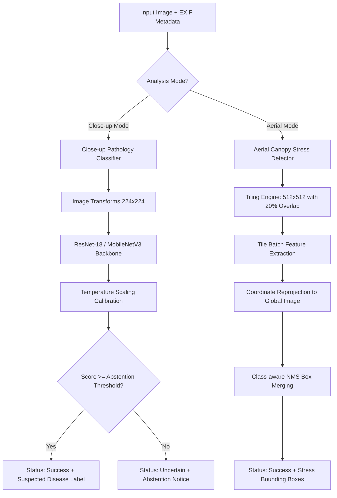

# AgriScan: Drone-Assisted Crop Health Monitoring & Environmental Risk Engine
### CropSentra | Mango AI MVP

AgriScan is the ML, microclimatic sensor analysis, and backend component of CropSentra. It receives close-up foliar imagery, timestamps, plot/tree identifiers, optional GPS metadata, and historical environmental sensor readings from external systems (such as drone ground stations or farm weather nodes), analyzes the evidence streams independently, and returns calibrated, structured findings.

The initial target crop is **Mango (*Mangifera indica*)**, prioritizing both:
1. **Close-up mango-leaf image classification** (using EfficientNet-B0 transfer learning and the SAR-MLD1-2025 dataset specifications).
2. **Environmental sensor-history analysis and combined multi-source assessment** (evaluating literature-grounded risk rules for Mango Anthracnose and Powdery Mildew).

---

## Core System Architecture & Modes

AgriScan strictly decouples and implements **two separate analysis modes**:



### 1. Close-Up Classification Mode (`close_up`)
- **Objective:** Classifies supported crop diseases from high-resolution leaf or fruit photographs taken by field scouts.
- **Backbone:** Transfer learning with frozen feature extractors and optional multi-stage fine-tuning (ResNet-18, MobileNetV3-Small, EfficientNet-B0).
- **Post-Hoc Calibration:** Temperature scaling on validation logits to prevent presenting raw softmax outputs as calibrated probabilities.
- **Uncertainty Abstention:** Configurable confidence threshold (tuned on validation data). Returns `status: "uncertain"` when below threshold.

### 2. Aerial Canopy Analysis Mode (`aerial`)
- **Objective:** Detects visible abnormal crop areas, stress zones, or canopy voids in drone orthomosaics and flight captures.
- **Tiling Engine:** Configurable slicing with overlap (e.g. 512x512 with 20% overlap), preserving global pixel coordinates.
- **Box Merging:** Non-Maximum Suppression (NMS) across overlapping tile detections.
- **Adapter Contract:** Implements the aerial contract, tiling pipeline, and data schema without falsely claiming an untracked real-world aerial model exists.

---

## Critical Agricultural Safety & Scientific Standards

> [!IMPORTANT]
> **Safety Policies & Operational Limitations**
> 1. **Model Non-Equivalence:** A model trained on close-up leaf photographs is **not** validated for aerial drone imagery.
> 2. **RGB Spectral Limitations:** Standard RGB imagery cannot reliably differentiate disease from nutrient deficiency (e.g. nitrogen chlorosis), water stress, soil compaction, or insect feeding without laboratory or in-field ground truthing.
> 3. **Sensor GPS vs. Plant Coordinates:** EXIF GPS metadata reflects the drone camera gimbal position at exposure time, not the exact position of an individual plant (due to altitude, tilt angle, lens field-of-view, and terrain).
> 4. **No Pesticide Recommendations:** AgriScan produces diagnostic screening triage only ("suspected disease", "visible crop stress"). It **never** generates chemical or pesticide recommendations.
> 5. **OOD Detection Boundary:** Confidence thresholds help filter low-confidence predictions, but **do not** reliably catch all out-of-distribution or unsupported crops.
> 6. **Explicit Demo Mode:** When running without trained weights, AgriScan explicitly declares `is_demo_mode: true` and will never silently substitute simulated results for real inference.

---

## Directory Layout

```
c:/AgriGuard/
├── agriscan/                    # Core Python package
│   ├── api/                     # FastAPI application and Pydantic schemas
│   │   ├── main.py              # GET /health, GET /model-info, POST /predict
│   │   └── schemas.py           # Validated request and response schemas
│   ├── data/                    # Dataset loaders, transforms, validation, and tiling
│   │   ├── dataset.py           # PyTorch datasets with farm-grouped splits
│   │   ├── validator.py         # Corrupt files, duplicates, class balance, leakage
│   │   ├── transforms.py        # Separate train vs eval transformations
│   │   ├── tiling.py            # Aerial overlap tiling and NMS box merging
│   │   └── synthetic.py         # Synthetic fixture generator
│   ├── models/                  # Neural network modules and calibration
│   │   ├── backbone.py          # Vision backbones with layer freeze/unfreeze
│   │   ├── classifier.py        # Close-up classifier wrapper and checkpointing
│   │   ├── aerial_adapter.py    # Aerial stress detector adapter and contract
│   │   └── calibration.py       # Temperature scaling and ECE computation
│   ├── training/                # Training engine with early stopping
│   │   └── trainer.py           # Two-phase transfer learning loop
│   ├── evaluation/              # Evaluation metrics and reporting
│   │   └── evaluator.py         # Precision, recall, macro F1, confusion matrix, ECE
│   └── inference/               # Production inference engine and metadata
│       ├── engine.py            # Unified dual-mode inference engine
│       └── exif_utils.py        # Drone EXIF GPS parsing with limitation notes
├── configs/                     # YAML configuration files
│   ├── close_up_config.yaml     # Close-up training & data settings
│   └── aerial_config.yaml       # Aerial tiling & detector settings
├── scripts/                     # Executable command-line tools
│   ├── prepare_synthetic_data.py # Generate smoke test fixtures
│   ├── validate_dataset.py      # Run dataset integrity & leakage checks
│   ├── train.py                 # Train model checkpoint with early stopping
│   ├── evaluate.py              # Run held-out test evaluation
│   └── run_inference.py         # Single image inference CLI
├── examples/                    # Sample API requests and responses
│   ├── predict_request_example.json
│   ├── predict_response_example.json
│   └── aerial_response_example.json
├── tests/                       # Complete Pytest test suite (24 tests)
├── checkpoints/                 # Model checkpoints and label mappings
├── Dockerfile                   # Container specification
├── MODEL_CARD.md                # Comprehensive model card documentation
├── pyproject.toml               # Package build metadata
└── requirements.txt             # Dependency specification
```

---

## Quickstart & Exact Commands

### 1. Environment Setup

```bash
# Clone repository
cd c:/AgriGuard

# Install dependencies and package in editable mode
pip install -r requirements.txt
pip install -e .
```

### 2. Generate Synthetic Test Fixtures

```bash
# Generates 24 synthetic multi-farm close-up images and aerial orthophoto fixture
python scripts/prepare_synthetic_data.py --output-dir data --samples-per-class 6 --num-farms 3
```

### 3. Validate Dataset Integrity & Leakage Prevention

```bash
python scripts/validate_dataset.py --data-dir data/close_up --metadata-file data/close_up/metadata.csv --group-col farm_id
```

Output includes:
- Total readable vs corrupt images
- Duplicate detection via SHA-256 content hashes
- Class distribution and imbalance ratios
- Verification of zero group leakage across train/val/test splits

### 4. Train Model with Early Stopping & Temperature Scaling

```bash
python scripts/train.py --config configs/close_up_config.yaml --epochs 5
```

Artifacts generated:
- `checkpoints/best_model.pth`: PyTorch checkpoint containing model state dict, architecture metadata, calibration temperature, and metrics.
- `checkpoints/label_mapping.json`: Canonical label-to-index and index-to-label mappings.

### 5. Evaluate on Held-Out Test Split

```bash
python scripts/evaluate.py --checkpoint checkpoints/best_model.pth --config configs/close_up_config.yaml
```

Reports:
- Per-class Precision, Recall, F1, and Support
- Macro F1
- Full Confusion Matrix
- Generalization performance broken down by held-out farm ID
- Expected Calibration Error (ECE) and confidence bin reliability

### 6. Run Single-Image CLI Inference

**Close-Up Leaf Inference:**
```bash
python scripts/run_inference.py --image data/close_up/tomato_healthy/farm_A_session_morning_tomato_healthy_000.jpg --mode close_up --crop tomato --checkpoint checkpoints/best_model.pth --threshold 0.70
```

**Aerial Tiling Inference:**
```bash
python scripts/run_inference.py --image data/aerial/ortho_farm_A_session_01.jpg --mode aerial --crop general_crop
```

### 7. Run the FastAPI REST Service

```bash
# Start server with Uvicorn
uvicorn agriscan.api.main:app --host 0.0.0.0 --port 8000 --reload
```

Endpoints available:
- `GET http://localhost:8000/health`: Service health, GPU availability, and model loading status.
- `GET http://localhost:8000/model-info`: Supported crops (includes `mango`), classes, sensor risk rules, and operational limitations.
- `POST http://localhost:8000/predict`: Close-up or aerial image diagnosis.
- `POST http://localhost:8000/sensors/upload`: Upload and validate historical sensor observations CSV into local storage.
- `POST http://localhost:8000/sensors/assess`: Query plot-specific microclimate history and evaluate literature-informed disease favorability rules.
- `POST http://localhost:8000/assess`: Multi-source combined assessment synthesizing image and sensor data into Section 9 contract.

#### Sensor CSV Schema (Version 1.0)
| Column | Type | Mandatory? | Description / Valid Range |
| :--- | :--- | :--- | :--- |
| `timestamp` | ISO 8601 string | **Yes** | e.g. `2026-10-10T12:00:00Z` (UTC convention) |
| `plot_id` | string | **Yes** | Unique orchard sector/plot identifier (e.g. `plot_mango_01`) |
| `air_temperature_c` | float | **Yes** | Ambient air temperature in °C (-10°C to +60°C) |
| `relative_humidity_pct` | float | **Yes** | Relative humidity in % (0% to 100%) |
| `soil_moisture_pct` | float | **Yes** | Volumetric soil water content in % (0% to 100%) |
| `tree_id` | string | No | Optional tree canopy ID (e.g. `tree_101`) |
| `crop` | string | No | Target species (default: `mango`) |
| `rainfall_mm` | float | No | Accumulated rainfall over interval (>= 0.0 mm) |
| `leaf_wetness_hours` | float | No | Leaf wetness duration in hours (>= 0.0) |
| `sensor_id` | string | No | Hardware sensor node identifier |
| `quality_flag` | string | No | Upstream flag (e.g. `valid`, `suspect`) |

> [!NOTE]
> **Synthetic Demo Fixture**: A small, clearly labelled synthetic sample CSV is included under `data/synthetic_sensors/sample_mango_sensor_history.csv` for hackathon and integration testing. Never treat synthetic fixtures as real farm measurements.

#### Example cURL Requests

**1. Upload Sensor CSV:**
```bash
curl -X POST "http://localhost:8000/sensors/upload" \
     -F "file=@data/synthetic_sensors/sample_mango_sensor_history.csv"
```

**2. Query Sensor Microclimate Risk:**
```bash
curl -X POST "http://localhost:8000/sensors/assess" \
     -H "Content-Type: application/json" \
     -d '{
       "plot_id": "plot_mango_01",
       "window_hours": 72.0,
       "target_timestamp": "2026-10-12T22:00:00Z"
     }'
```

**3. Run Combined Multi-Source Assessment:**
```bash
curl -X POST "http://localhost:8000/assess" \
     -F "crop=mango" \
     -F "plot_id=plot_mango_01" \
     -F "timestamp=2026-10-12T22:00:00Z" \
     -F "window_hours=72.0" \
     -F "file=@data/close_up/tomato_healthy/farm_A_session_morning_tomato_healthy_000.jpg"
```

### 8. Inspect & Validate Mango Dataset (SAR-MLD1-2025)

```bash
python scripts/validate_mango_dataset.py --dataset_dir data/mango_sar_mld1
```

Checks:
- Completeness across the 5 classes: `healthy`, `anthracnose`, `powdery_mildew`, `turning_brown`, `gall_midge`.
- File decode integrity and corruption detection.
- Near-duplicate perceptual hashing.
- Attribution and Mendeley license compliance (CC BY 4.0).

### 9. Run Complete Test Suite

```bash
pytest tests -v
```
All **46 tests** cover:
- Sensor CSV schema validation, timestamp parsing, deduplication, and gap detection
- Sensor derived feature calculations and trend regression
- Literature-grounded risk rules for Mango Anthracnose and Powdery Mildew
- Abiotic heat and soil moisture stress detection
- Multi-modal combined assessment (image-only, sensor-only, concordant, discordant, insufficient data)
- Section 9 API contract compliance
- FastAPI REST endpoints: `/health`, `/model-info`, `/predict`, `/sensors/upload`, `/sensors/assess`, `/assess`
- End-to-end mango pipeline smoke test
- Aerial tiling and NMS box merging
- Uncertainty calibration (temperature scaling and ECE)

---

## Docker Deployment

### Build Container
```bash
docker build -t agriscan:latest .
```

### Run Container
```bash
docker run -d -p 8000:8000 --name agriscan-service agriscan:latest
```

### Verify Container Health
```bash
curl http://localhost:8000/health
```

---

## Sourcing & Integrating Real Datasets

To replace the synthetic testing fixture with real-world agricultural data:

1. **Verify Licensing:** Only use datasets with clear commercial or research licenses (e.g., CC-BY-4.0, MIT, or formal institutional field trials).
2. **Directory Structure:**
   Organize your raw images into either:
   - **Option A (Subfolder layout):** `data/close_up/<disease_class>/<image_filename>.jpg` (ensure filename contains farm/session ID e.g., `farm01_sessionA_001.jpg`).
   - **Option B (CSV layout):** Place images in `data/close_up/images/` and provide `data/close_up/metadata.csv` with columns:
     ```csv
     image_path,label,crop,farm_id,session_id,gps_lat,gps_lon
     ```
3. **Execute Validation:** Run `python scripts/validate_dataset.py` to identify unreadable images, corrupt files, duplicates, and ensure zero farm leakage.
4. **Hardware Requirements:**
   - **Smoke Tests / Pipeline Validation:** CPU (fully tested and functional).
   - **Real Model Production Training:** NVIDIA GPU with >= 8GB VRAM (e.g., RTX 3070, T4, A10) recommended for batch size 32 across 30+ epochs.
